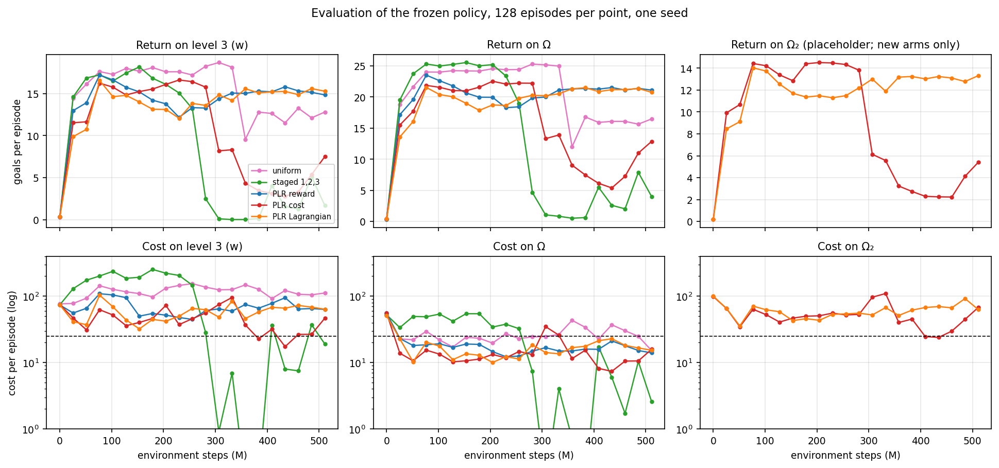
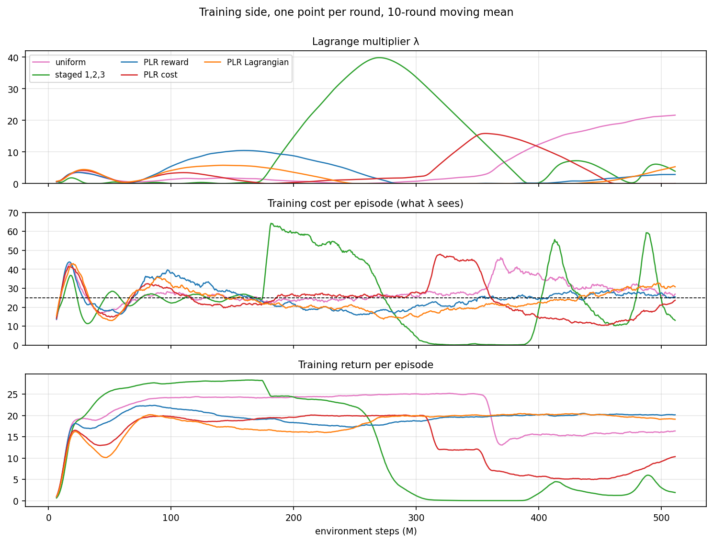
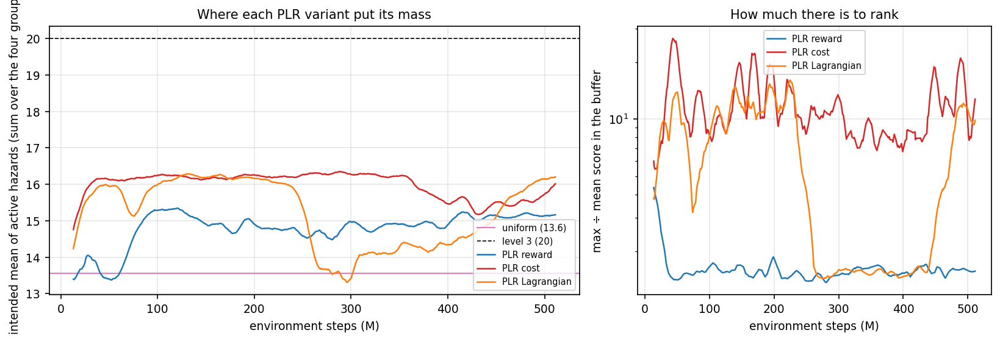

# Uniform vs staged vs PLR × {reward, cost, Lagrangian} on `safe_goal_point`, 500 M steps

Done 2026-10-12. W&B group `goal_point_plr_scores_500M`. One seed. Plan item 2:
the three PLR score variants against the two manual baselines, on the same stack
as the 2026-10-08 experiment plus the third evaluation target Ω₂ (placeholder
values, `design/goal_point_out_of_distribution.md`).

Only the two new PLR arms are run. The other three arms are the 2026-10-08 v2
runs, reused: the diff between the code they ran on (`242f0a6`) and this one
(`bf65448`) does not touch their training path (`crax/` unchanged; the loss's
`A_r − λA_c` moved into a shared function with identical arithmetic; uniform,
staged and the reward-scored PLR behave as before). They are moved into this
group after the new arms are in, so one dashboard shows all five; they have no
Ω₂ evaluation and their config lists two targets, so the Ω₂ panels carry two
lines and `python -m training.dashboard --group` must not be used to rebuild
this group's view (it requires all runs' facts to agree).

## Question

The 2026-10-08 run found the reward critic about equally wrong across Ω
(score max/mean 1.6) while the cost critic's error varied 4×. Does ranking by
the cost critic's error, or by the error of the Lagrangian objective the policy
actually optimises, move PLR's mass further towards the dense end of Ω than
the reward score did — and does that translate into lower cost on level 3
without the return dropping? Secondary: with Ω₂ evaluated on every arm, how do
the five policies rank on contexts none of them could have trained on?

## Setup

Identical to 2026-10-08 except for the three PLR arms and the Ω₂ evaluator.
PPO-Lagrange, `safe_goal_point`, 8192 envs, 1000-step episodes, budget 25,
763 rounds of 655 360 steps, 21 evaluations of 128 episodes on level 3, on
Uniform(Ω) and on Uniform(Ω₂).

| arm | `--context_distribution` | PLR score (mean \|·\| over the episode) | run |
|---|---|---|---|
| uniform | `uniform` | — | 2026-10-08 v2, reused |
| staged | `staged:1,2,3` | — | 2026-10-08 v2, reused |
| plr | `plr` | reward advantage (the paper) | 2026-10-08 v2, reused |
| plr:cost | `plr:cost` | cost advantage | **new** |
| plr:lagrangian | `plr:lagrangian` | $A_r - \lambda A_c$, both standardised, the round's λ | **new** |

PLR hyperparameters as before: buffer 1000, β = 1, ρ = 0.3, p = 0.5.

`scripts/experiments/goal_point_plr_scores_500M.sh`, run with `nohup`:

```bash
COMMON="--env_name safe_goal_point --alg ppo_lag --seeds 0 \
  --num_envs 8192 --num_timesteps 500_000_000 --num_evals 21 --episode_length 1000 \
  --unroll_length 20 --batch_size 1024 --num_minibatches 32 --num_updates_per_batch 4 \
  --safety_bound 25 --deployment_distribution level:3 \
  --store_model false --skip_rollout --skip_video --measure_performance --quiet \
  --wandb_group goal_point_plr_scores_500M"
for ARM in plr:lagrangian plr:cost; do
  .venv/bin/python -m training.train_env $COMMON --context_distribution $ARM
done
```

Smoke before launch (10 rounds of `plr:lagrangian`, deleted afterwards): 0
recompiles, 80–82 k SPS with the third evaluator, buffer full by round 2, score
mean 0.52 → 0.82 (max 3.1) in standardised units, all three
`<signal>_value_loss/<d>` heatmaps logged, `evaluation/out_of_distribution/*`
present with 1000-step episodes and already harder than Ω (cost 143 vs 52 at
round 10).

Mechanics of the two new arms: 0 recompiles, 86 k SPS with the third evaluator;
every evaluation episode ran 1000 steps. Figures:
`scripts/analysis/goal_point_plr_scores_figures.py`.

## Results

### The policy on the three targets



Mean of the last five evaluations (400–510 M); Ω₂ exists for the new arms only.

| arm | level 3 return | level 3 cost | Ω return | Ω cost | Ω₂ return | Ω₂ cost | Ω under budget |
|---|---|---|---|---|---|---|---|
| uniform | 12.5 | 108 | 16.0 | 26 | — | — | 13 / 21 |
| staged | 2.7 | 22 | 4.4 | 8 | — | — | 10 / 21 |
| PLR reward | 15.3 | 73 | 21.3 | 17 | — | — | 20 / 21 |
| PLR cost | 4.4 | 30 | 8.5 | 10 | 3.3 | 38 | 18 / 21 |
| PLR Lagrangian | **15.2** | **68** | 21.1 | 19 | 13.1 | 72 | 20 / 21 |

- **PLR Lagrangian ends where PLR reward ends.** Same return on level 3 and
  on Ω, level-3 cost 68 vs 73 — inside the evaluation noise (± 15). The score
  that includes λ did not produce a different policy from the score that
  ignores it. It did get there differently (next figure).
- **PLR cost was the best arm at 300 M and the worst at 450 M.** Level-3
  return 16.5 and cost 46 at 230 M — lower cost than any other moving arm at
  that point — then a fall to 3 goals between 280 and 400 M. Its end-of-run
  cost of 30 is a policy that reaches few goals, not a safe one; unlike
  staged it is not motionless (training return 5–7, climbing to 10 at the
  end) and is recovering.
- **Ω₂ ranks the two new arms the same way Ω does**, at lower return and
  ~4× the cost. With one shift confounded with another and no reference arm,
  that is all it can say (`design/goal_point_out_of_distribution.md`).

### Why: λ, again — and this time the curriculum pulled the trigger



- **PLR cost's collapse is the staged failure without a stage switch — and
  without the curriculum moving at all.** Intended, sampled and experienced
  hazard counts are 16.2–16.3 from 50 M to the end; the distribution the
  policy failed on at 300 M is the one it had held at return 20 for 350
  rounds. What differed from the other PLR arms is *where cost sat*: on 16.3
  hazards the policy's training cost was 26.2 against a budget of 25 (PLR
  reward and Lagrangian, on 14.8 hazards: 18, λ = 0). A leak-free integrator
  with a +5 % excess winds up on it: λ 0.35 → 2.3 over rounds 300–460 with
  nothing else changing. At λ ≈ 2.3 the update tipped — within 15 rounds cost
  27 → 47 and return 20 → 12, the cost critic's error rising uniformly across
  every hazard count (0.5 → 0.7: the policy changed everywhere, no region of Ω
  got harder) — and the rest is the wind-up: λ 2 → 16 (peak 353 M), return
  given up to drive cost to 10, λ back at 0 by 456 M. The cost score did not
  feed the policy harder contexts; it parked the policy *at* the budget
  instead of under it, and that is where an integrator has no margin.
- **PLR Lagrangian had the lowest λ peak of any arm (5.8)** and no collapse.
  Its λ was 0 from 242 M to 428 M with cost under budget and training return
  the highest of the five (20); it is rising again at the end (cost 31, λ 5).
  The same λ → 0 regime as PLR reward's at 300–430 M.
- Uniform's late wind-up (λ 22, still rising) and staged's are as in the
  2026-10-08 result; nothing here changes that reading.

### What each score ranked, and where it sent the mass



- **Left: cost ranks hardest.** Mean active hazards intended: uniform 13.6,
  PLR reward 15.2, PLR Lagrangian 16.2 (end), PLR cost 16.2 (steady from
  50 M to 330 M). The cost critic's error is largest where hazards are densest, so a
  cost-scored PLR is a steady pull towards level 3 — which is what the
  constrained reading of PLR asked for, and what broke the controller.
- **Right: the Lagrangian score is λ in disguise.** Its max/mean spread
  follows λ: 10.5× on average while λ > 1, 1.6× while λ ≈ 0 (242–428 M) — the
  reward score's own floor (median 1.55×). The cost score's is 9.4× throughout. The design doc said
  this would happen (*"when λ → 0 it is the reward score in standardised
  units"*); here it is. Its mass curve shows the same thing — a PLR-cost-like
  pull while λ is up, a fall to uniform's level when λ is 0 — and that
  oscillation is why it did not collapse: every time cost started to bite, λ
  rose, the score became cost-like, mass moved to dense layouts, λ did its
  work, and the score let go again before the integrator wound up.
- **The reward score has nothing to rank** (max/mean 1.5× for 480 M), as in
  the 2026-10-08 result. The cost score always has ≈ 10×.

## What this changes in the plan

1. **The controller, not the curriculum, still decides the end state** — now
   demonstrated on a *stationary* curriculum: PLR cost held one distribution
   for 700 rounds and still collapsed, because that distribution put training
   cost 5 % over budget and the integrator has no leak. PPO-PID before any
   further PLR comparison, as already planned; PLR cost is the arm most worth
   rerunning under PID, since it had the best policy of the five at 300 M.
   Hypothesis to test there, not provable from one seed: the trigger is λ above
   ~2 *while* the policy has no cost margin (PLR reward reached λ = 9 with 7
   of slack and did not tip).
2. **`plr:lagrangian` is not a third score; it is a λ-gated switch between the
   other two.** Keep it as an arm — the gating is exactly the self-limiting
   behaviour one would want — but read its results as "cost score when λ > 0,
   reward score otherwise", not as a new objective.
3. **Ω₂ stays a placeholder.** The two arms rank the same on Ω₂ as on Ω and
   the gap is a difficulty gap; nothing is learned from it until the design
   question is answered.
4. Open: at 1000 rows and β = 1 every variant's `replay_mass/top_10` is 0.28
   (the closed form) regardless of how much spread the score has. The cost
   score has 10× to rank and uses it only through rank order. β < 1 on the
   cost score is the first hyperparameter worth a run.
