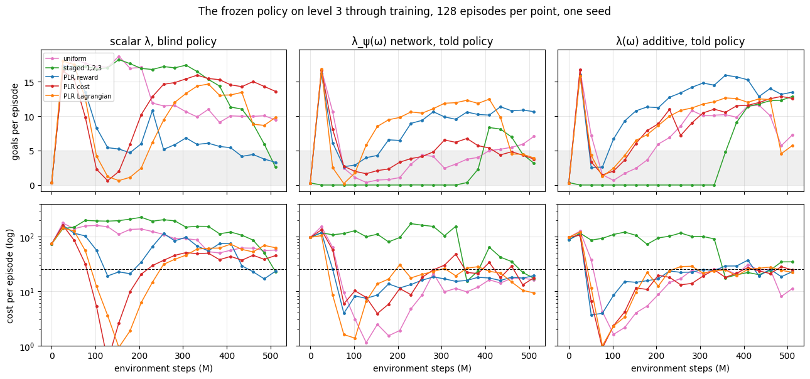
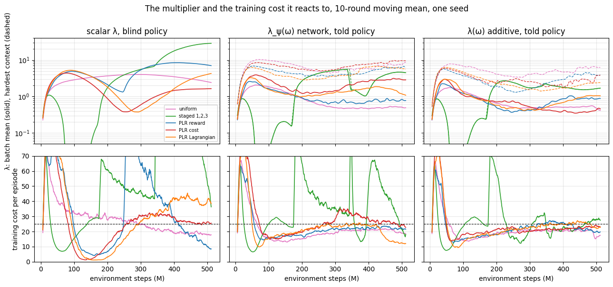

# Five distributions under three learners on `safe_goal_point`, 500 M steps: the per-context constraint puts every arm on budget on level 3, the scalar constraint none

Done 2026-10-15 on Snellius (first experiment there; 15 arms in parallel, 1 h 51
each on an A100, ~3,500 SBU). W&B group `goal_point_learners_500M`, one seed,
commit `eb19638` (branch `experiment/goal_point_learners_500M` =
`contextual-learner` + the Snellius launcher). Plan task 1.

## Question

Every run so far ended with cost at the budget on the training distribution and
three to four times the budget on level 3, because PPO-Lagrange's one multiplier
settles where the policy is on budget for whatever the curriculum samples
(`research_design_brief.md` §6). Task 1 makes the CMDP contextual: the policy is
told its context and the multiplier is a function of the context, λ(ω), in one
of two function classes (`design/contextual_learner.md`). Does that put cost on
level 3 at the budget, for every training distribution, and what does the
policy's return on level 3 and on Ω pay for it? The 100 M smoke
(`smoke_contextual_learner_v2`) had the per-context arms meeting the level-3
budget by standing still; is 500 M enough to find a policy that moves?

## Setup

PPO-Lagrange, `safe_goal_point`, 8192 envs, 1000-step episodes, budget 25,
763 rounds of 655 360 steps, 21 evaluations of 128 episodes on level 3 (w), on
Uniform(Ω) and on the Ω₂ placeholder. The multiplier's learning rate is 1 and
its initial value 0.1 in every arm (the `network` class needs a positive start;
the scalar baselines take the same value so the arms are comparable). The
scalar arms are therefore the rate-1 reruns of the earlier baselines, not the
rate-10 runs of `2026-10-11_goal_point_plr_scores_500M.md`.

| learner | `--constraint` | `--policy_context` | what it is |
|---|---|---|---|
| scalar blind | scalar | blind | the published PPO-Lagrange: one λ from the batch mean cost, policy sees sensors only |
| network told | network | told | λ_ψ(ω) = softplus(MLP(ω)), fitted each round to the integrator's per-transition targets; policy and critics see {sensors, context} |
| additive told | additive | told | λ(ω) = f(Σ h_i(ω_i)), monotone per factor, monotone price; same observation |

Five training distributions under each: `uniform`, `staged:1,2,3`, `plr`
(reward score), `plr:cost`, `plr:lagrangian`. PLR as before: buffer 1000, β = 1,
ρ = 0.3, p = 0.5. The experiment is `scripts/experiments/goal_point_learners_500M.py`:

```bash
.venv/bin/python -m training.experiments.snellius scripts/experiments/goal_point_learners_500M.py \
  --partition gpu_a100 --time 05:00:00
# COMMON: --env_name safe_goal_point --alg ppo_lag --deployment_distribution level:3
#   --initial_lambda_lagr 0.1 --lagrangian_coef_rate 1
#   --num_envs 8192 --num_timesteps 500_000_000 --num_evals 21 --episode_length 1000
#   --unroll_length 20 --batch_size 1024 --num_minibatches 32 --num_updates_per_batch 4
#   --measure_performance --skip_rollout --skip_video --store_model true
```

Mechanics: 0 recompiles on every arm, 93–94 k SPS (local reference 85 k), every
evaluation episode 1000 steps, checkpoints in each run's W&B files. Figures:
`scripts/analysis/goal_point_learners_figures.py`.

**One row is confounded.** `staged:1,2,3` under a told policy is unreadable for
its first 350 M steps: the observation normaliser keeps a running standard
deviation per input and clips it at 10⁻⁶; one context per stage gives the
context inputs zero variance, so at evaluation the level-3 context normalises
to ±6·10⁶ and the policy outputs nothing useful (evaluation return exactly 0.0
on level 3 *and* on Ω for 14 evaluations while training return is 23–29). The
cube counts are 0 in both level 1 and level 2, so this lasts until the switch
to level 3; the two staged-told arms are 170 M-step runs from that point. Also
at each switch the told arms' training return drops where the blind arm's does
not (28.8 → 12.1 vs 27.3 → 24.9 at the level-2 switch). Reproduced in
isolation; README *Known defects*. Uniform and the PLR arms draw a fresh context
every episode and are unaffected.

## Results

### Every per-context arm ends at the budget on level 3 and no scalar arm does


Mean of the last five evaluations (400–510 M). Evaluation-to-evaluation
scatter over those five: cost ± 5, return ± 1. "L3 ≤ budget" counts the last
ten evaluations under 25.

| distribution | learner | L3 return | L3 cost | L3 ≤ budget | Ω return | Ω cost | λ peak (mean / hardest context) |
|---|---|---|---|---|---|---|---|
| uniform | scalar blind | 9.9 | 58 | 0 / 10 | 16.8 | 17 | 4.0 |
| uniform | network told | 5.7 | 16 | 10 / 10 | 19.2 | 22 | 2.1 / 10.4 |
| uniform | additive told | 9.2 | 20 | 6 / 10 | 22.0 | 18 | 1.8 / 7.9 |
| PLR reward | scalar blind | 4.2 | 33 | 3 / 10 | 7.4 | 16 | 8.5 |
| PLR reward | network told | 10.8 | 18 | 10 / 10 | 23.8 | 22 | 2.6 / 6.9 |
| PLR reward | additive told | **13.8** | **24.5** | 6 / 10 | **24.5** | 20 | 2.3 / 5.7 |
| PLR cost | scalar blind | 14.4 | 42 | 0 / 10 | 20.6 | 16 | 4.4 |
| PLR cost | network told | 4.5 | 22 | 6 / 10 | 20.1 | 24 | 4.0 / 9.8 |
| PLR cost | additive told | 12.3 | 24.8 | 8 / 10 | 23.7 | 20 | 3.0 / 6.0 |
| PLR Lagrangian | scalar blind | 10.8 | 63 | 0 / 10 | 16.4 | 26 | 5.2 |
| PLR Lagrangian | network told | 7.0 | 16 | 7 / 10 | 19.5 | 17 | 3.3 / 6.8 |
| PLR Lagrangian | additive told | 9.4 | 25 | 6 / 10 | 21.0 | 22 | 3.0 / 6.3 |
| staged 1,2,3 | scalar blind | 8.0 ↓ | 78 ↓ | 1 / 10 | 12.7 | 23 | 28.8 |
| staged 1,2,3 | network told † | 6.2 | 36 | 4 / 10 | 9.3 | 26 | 5.6 / 5.8 |
| staged 1,2,3 | additive told † | 12.1 | 27 | 5 / 10 | 5.2 | 13 | 2.7 / 2.7 |

† confounded (Setup). ↓ still falling: staged-scalar's last two evaluations are
5.9 / 51 and 2.6 / 23, λ at 29 and rising — the motionless end state of the
rate-10 run, arriving later.

- **The per-context constraint holds on level 3.** All eight uniform and PLR
  arms under λ(ω) end with level-3 cost between 16 and 25; no scalar arm is
  under 33, and uniform, PLR Lagrangian and staged are at two to three times
  the budget. Across the last ten evaluations the told arms are under budget
  6–10 times out of 10, the scalar arms 0–3.
- **The told policy holds a different behaviour per context.** Under λ(ω) the
  same policy that scores 16–25 cost on level 3 scores 19–24.5 goals on Ω: it
  moves freely where it may and carefully where it must. The blind policies
  show the one-trade-off signature: PLR reward blind reaches 7.4 goals on Ω and
  4.2 on level 3 (motionless everywhere; λ peaked at 8.5, 7.0 at the end);
  uniform blind 16.8 and 9.9 with level-3 cost 58.
- **Return on level 3 is the price, and it ranges 4.5–13.8.** PLR reward
  additive is the best policy of the fifteen on both targets at once (13.8 goals
  under budget on level 3, 24.5 on Ω). Within a learner the five distributions
  spread over 5–14 goals on level 3 at the same cost; across learners the
  additive form ends with more return than the network on all four unconfounded
  distributions (uniform 9.2 vs 5.7, PLR 13.8 vs 10.8, PLR cost 12.3 vs 4.5,
  PLR Lagrangian 9.4 vs 7.0; staged, confounded, 12.1 vs 6.2 as well).
- **Scalar PLR reward collapsed to standing still** (Ω return 7.4, level-3 4.2),
  as the rate-10 staged arm did on 2026-10-09 — here with no stage switch, λ
  wound to 8.5 and the mass drifting to sparser layouts (12.0 hazards at the
  end, uniform's mean is 13.6). The rate-1 scalar baselines do not reproduce the
  rate-10 ordering (`2026-10-11`: PLR reward 15.3 / 73, PLR cost 4.4 / 30; now
  4.2 / 33 and 14.4 / 42); with one seed the scalar end states are not stable
  between runs, the told end states on level-3 cost are.

### The told arms meet the budget by standing still first, then learn to move within it



- **Every told uniform and PLR arm follows the same path**: 16–17 goals at
  26 M with cost 105–155 (the untrained λ), then level-3 return falls to 0.2–2.7
  by 51–128 M while level-3 cost falls to 1–8 — far under budget, the smoke's
  motionless policy — then return climbs back to 5–14 by 500 M with cost
  settling at the budget from below. First evaluation back above 8 goals:
  PLR reward additive 128 M, PLR Lagrangian network 153 M, PLR cost additive and
  PLR Lagrangian additive 204 M, PLR reward network 230 M, uniform additive
  256 M; uniform network and PLR cost network never (5.7 and 4.5 at the end,
  still rising). At 100 M only the motionless policy met the level-3 budget;
  at 500 M a moving one does. Task 1's question is answered yes, at 500 M.
- **The scalar arms go the other way**: they hold 17–18 goals on level 3 for
  150–250 M at cost 100–230, and lower cost only by losing return later. Their
  return on level 3 at the end (4–14) overlaps the told arms'; their cost does
  not.
- **The staged scalar arm is the 2026-10-09 failure at a slower clock**: cost
  on level 3 ≥ 100 for 400 M, then λ (29 at the end, rising) drives return
  down through the last four evaluations. The rate change from 10 to 1 slowed
  the wind-up; it did not change where it goes.

### What the multiplier did: the hardest contexts keep a high λ while the mean falls



- **Under λ(ω) the batch-mean λ falls to 0.5–1 while λ at the round's hardest
  context stays at 2–10** (dashed lines). It peaks at 5.7–10.4 in the first
  100 rounds on six of the eight arms; the integrator at rate 1 unwinds at most
  ~0.025 per round, so the dense end comes down to 1.5–5 only by round 450 —
  the same window in which level-3 return climbs back. The function holds the
  contexts apart: fit error 0.17–0.24 against a target spread of 0.4–2.2 on
  every uniform and PLR told arm.
- **The told arms' training cost rises from 14–19 (150–300 rounds) to 20–28
  at the end**: the constraint binds on the training distribution and, through
  λ(ω), on level 3 at the same time. The scalar arms' training cost is also at
  budget (13–26) except staged (72) and PLR Lagrangian (40); their level-3
  cost is 33–78. One constraint on the batch mean cannot serve both.
- **The network form's λ at the hardest context is higher than the additive
  form's** on all four unconfounded distributions (10.4 vs 7.9 uniform, 6.9 vs
  5.7 PLR, 9.8 vs 6.0 PLR cost, 6.8 vs 6.3 PLR Lagrangian) and its level-3
  return lower. The additive form's monotone price is a
  bound from the neighbours; the network's extrapolation at the dense corner is
  free, and here it ran high.
- **PLR moved its mass little under λ(ω)**: 15.5–15.8 hazards intended at the
  end for all six told PLR arms (uniform 13.6; the rate-10 scalar runs had
  reward 15.2, cost 16.2). Scalar PLR reward went the other way, to 12.0 — the
  reward score ranked the sparse contexts up as the policy stopped moving.
  Whether the curricula differ under λ(ω) is a question for the twins (task 3);
  this run says only that their end states on level 3 do (5–14 goals at the
  same cost).

### The budget is met in the mean, not in the typical episode: every policy fails the same way, the per-context one ten times less often

Added 2026-10-16 from replaying four checkpoints on level 3, 384 episodes each
(3 seeds × 128, the sampling policy the run evaluated with; `training.replay`,
branch `replay-checkpoint`; the episodes are recorded and open in the review page).

| arm | mean cost | median | p99 | ≤ budget | > 2× budget | > 4× budget | worst |
|---|---|---|---|---|---|---|---|
| PLR reward additive told | 17.6 | 13.5 | 80 | 81 % | 3.6 % | 0.5 % | 247 |
| PLR reward network told | 19.3 | 15.1 | 107 | 78 % | 4.9 % | 1.3 % | 235 |
| PLR cost scalar blind | 42.3 | 26.6 | 370 | 46 % | 15 % | 6.8 % | 807 |
| uniform scalar blind | 64.0 | 29.9 | 504 | 40 % | 29 % | 15 % | 1374 |

- **The typical level-3 episode of the per-context arms costs 13–15, well under
  the budget; the mean is carried by a tail.** One episode in 200 costs ten times
  the budget. A constraint stated on the mean is met by a policy whose failures
  are few and large; the evaluation's `episode_cost_std` (53 against a mean of
  23 in the final evaluation) was saying so.
- **Every policy has the same failure, and the per-context constraint makes it
  ten times rarer.** In every arm the episodes over 100 are solid-hazard contact
  (3 per costly step) while the agent keeps moving (speed 0.05–0.07, as in
  under-budget episodes): the agent presses against a wall of solid cylinders
  that stands between it and the goal, never finding the way round (episode 88
  of seed 2, `plr additive told`: two goals by step 223, then 780 steps against
  four cylinders in a line; videos in the review). The scalar blind policies do
  this in one episode of seven, the told ones in one of 80–200. The learner
  changed how often the failure is triggered, not what it is.
- **The observation cannot contain the fact that decides these episodes.** The
  hazard lidar is one 16-bin reading over all 30 hazards, closeness of the
  nearest centre per sector, no kind: a flat disc the agent may cross and a solid
  cylinder it cannot produce the same reading (`safe_goal.py`, the one
  `hazard_lidar` array). Verified on episode 88: the recorded lidar is
  reproduced from the scene to 0.005, and swapping the roles of a solid blocker
  and a nearby disc leaves it unchanged. Were every solid hazard a disc, the
  observation at every step of the episode would be identical and the cost 0.
  Extent and occlusion are dropped too (centres only; everything seen through
  everything). A policy with memory would at least learn that it had tried;
  neither remedy exists in a reactive MLP over this sensor.
- Replaying the mean action instead of sampling gives the same return (12.3 vs
  13.5) and the same typical cost; it is not a safer agent. Rollouts are not
  bitwise reproducible across processes (same seed, worst episode 63 vs 387),
  so a catastrophic episode is kept by recording it, not by its seed.

## What this changes in the plan

1. **The learner is settled: per-context constraint, told policy.** It does
   what task 1 asked — level-3 cost at the budget for every distribution, return
   on Ω held at 19–24.5 — and the scalar learner does not for any. Every later
   arm runs under it; the scalar learner stays as the published baseline row.
   Between the two forms, `additive` ends with more return at the same cost on
   all four unconfounded distributions and its hardest-context λ runs lower; it
   is the default. The `network` form stays available.
2. **Fix the context normaliser before any staged arm is run again.** The
   context has known bounds (the Ω box, which the λ network already uses to
   scale its input); normalise it by those, not by running statistics. The two
   staged-told rows are rerun after the fix; nothing in this result depends on
   them.
3. **The blind-policy control** (`staged:1,2,3 network blind`) is still owed
   and now has a clean prediction to test: under λ(ω) with a blind policy the
   level-3 cost should not stay at the budget, because PLR reward blind shows
   what one trade-off for all contexts looks like.
4. **Seeds.** The told arms' level-3 cost is consistent across eight arms; the
   return on level 3 spreads 4.5–13.8 with no visible pattern across
   distributions and the scalar arms re-ordered against the rate-10 run. Seeds
   1–2 of this experiment (with episode records, once `episode-review` is
   merged) before any claim about *which* distribution is best under λ(ω).
5. **Snellius is the way to run experiments**: fifteen 500 M arms in under two
   hours, ~3,500 SBU of the 37,000 that expire 2026-10-31 (33,400 left).
6. **Report the per-episode cost distribution, not the mean alone.** The
   evaluator logs the mean and its standard deviation; the fraction of episodes
   over the budget and over a multiple of it is what the budget's meaning rests
   on, and should be logged every evaluation for every arm.
7. **The observation moves to vision** (decision 2026-10-16). The lidar drops
   hazard kind, extent and occlusion, and a fix to the lidar would be
   goal-point's alone; a camera carries the same information on every suite and
   the benchmark already renders pixels (`--vision`, `GpuPixelObservationWrapper`,
   `docs/VISION_TRAINING.md`). It is a retrain of every arm and a composition of
   the vision networks with the contextual learner's `{sensors, context}`
   observation, which `train_env` today refuses together. Not a cost cap and not
   a stuckness terminator: both would end the episodes the measurement is about
   and change the constraint's meaning.
