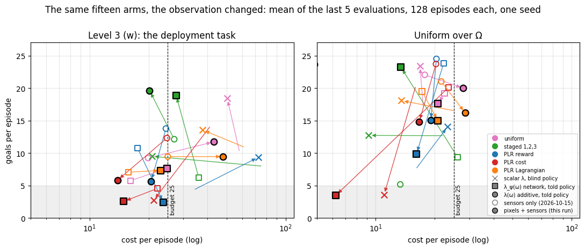
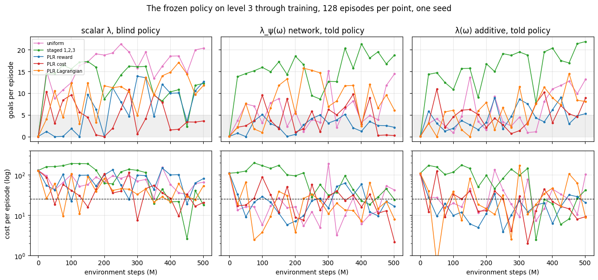
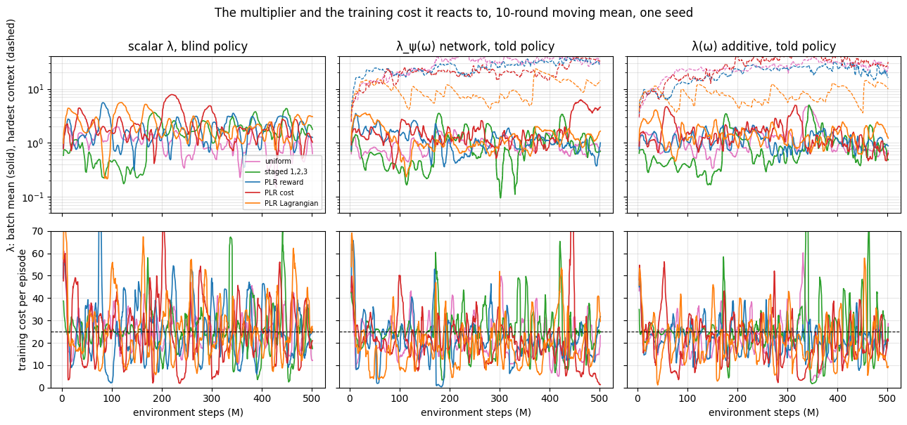

# The fifteen arms again, the policy seeing pixels: the staged curriculum under λ(ω) gives the best policy of either run, the uniform and PLR told arms lose the return they had, and every arm now swings between evaluations

Done 2026-10-17 on Snellius: 15 arms in parallel, 5 h 30–44 each on an A100,
~10,900 SBU. W&B group `goal_point_learners_vision_500M`, one seed, commit
`6bc54c7` (branch `contextual-review`). The same arms, flags and budget as
`2026-10-15_goal_point_learners_500M.md`, with the observation changed; that
report is the comparison throughout.

**In one paragraph.** With a camera next to the sensors, the per-context
constraint still holds the level-3 budget where the scalar one does not (7 of 10
told arms end within 25, 2 of 5 scalar arms, one of them standing still), but the return it buys changed
sides: the `staged:1,2,3` told arms, unreadable on 2026-10-15 and now clean,
end at 19–20 goals on level 3 at cost 20–28 and 23–24 goals on Ω — the best
policies of either experiment — while the uniform and PLR told arms, the best
of 2026-10-15, end at 2–12 goals and none of the eight is both above 8 goals and
under budget. Every arm's evaluations swing two to five times further between
consecutive evaluations than two days ago, far more than the sampling error of
128 episodes, and the multiplier oscillates with a 20–40 M-step period: the
frozen policy is a different policy at every evaluation. This run changed two
things at once — the observation, and (through 1024 environments instead of
8192) the number of multiplier updates per environment step, eight times more —
and cannot say which did what; the next run must separate them.

## Question

2026-10-15 ended with the learner settled (per-context λ(ω), told policy) and a
failure it could only make rarer, not remove: the lidar cannot tell a flat disc
from a solid cylinder, so the policy presses into walls it cannot see as walls
(plan item 7). A camera carries that fact. Does the same experiment from pixels
plus sensors keep the budget on level 3, and does the return under the budget go
up now that the observation contains what decides the costly episodes? The
normaliser fix (plan item 2) is in this run, so the two staged-told rows are
read for the first time.

## Setup

PPO-Lagrange, `safe_goal_point`, episodes of 1000 steps, budget 25, 21
evaluations of 128 episodes on level 3 (w), on Uniform(Ω) and on Ω₂. The policy
observes `{sensors, context, pixels/vision}`: a 64 × 64 egocentric camera,
three frames stacked, through one Nature-CNN encoder shared by the policy and
both critics, next to the sensors (`design/contextual_learner.md` §2;
`training/contexts/networks.py`). Learners and distributions as on 2026-10-15.
What differs from that run, besides the observation, is the batch shape the
renderer's memory forces:

| | 2026-10-15 (sensors) | this run (pixels + sensors) |
|---|---|---|
| environments | 8192 | 1024 |
| minibatches × updates | 32 × 4 | 4 × 4 |
| steps per round | 655 360 | 81 920 |
| rounds in 500 M | 763 | 6104 |
| multiplier updates per 100 M steps (rate 1 per round) | 153 | 1221 |
| SGD steps per 100 M steps | 19 500 | 19 500 |
| steady throughput | 93 k SPS | 26.8 k SPS |
| wall per arm | 1 h 51 | 5 h 40 |

```bash
.venv/bin/python -m training.experiments.snellius scripts/experiments/goal_point_learners_vision_500M.py \
  --partition gpu_a100 --time 08:00:00
# COMMON: --env_name safe_goal_point --alg ppo_lag --deployment_distribution level:3
#   --initial_lambda_lagr 0.1 --lagrangian_coef_rate 1
#   --vision --vision_obs_mode pixels+state --gpu_memory_fraction 0.75
#   --num_envs 1024 --num_timesteps 500_000_000 --num_evals 21 --episode_length 1000
#   --unroll_length 20 --batch_size 1024 --num_minibatches 4 --num_updates_per_batch 4
#   --record_episodes 4 --store_model true --measure_performance --skip_rollout --skip_video
```

Mechanics: one compiled epoch program per arm, 0 recompiles, 26.6–27.2 k SPS;
every arm leaves 252 episode records (4 episodes × 3 targets × 21 evaluations,
0.6 GB, each with the frames the policy saw) and 21 whole-learner checkpoints in
its W&B files; `training.review --group goal_point_learners_vision_500M` opens
the records. Figures: `scripts/analysis/goal_point_learners_vision_figures.py`.

**The staged-told rows are clean.** The context now enters every network scaled
by Ω's bounds, not by running statistics (README *Known defects*, fixed
2026-10-16): the staged told arms score 14 goals on level 3 at their second
evaluation where on 2026-10-15 they scored exactly 0.0 for fourteen.

## Results

### The end states moved: staged told up to 20 goals on budget, uniform and PLR told down to 2–12



Each arrow is one arm, from its 2026-10-15 end state (hollow) to this run's
(filled); mean of the last five evaluations. The numbers:

| distribution | learner | L3 return (sensors → pixels) | L3 cost | Ω return | Ω cost | L3 ≤ budget, of 21 |
|---|---|---|---|---|---|---|
| staged 1,2,3 | additive told | 12.1 † → **19.6** | 27 → **20** | 5.2 † → **23.6** | 13 → 5 | 5 (of 7 on level 3: 5) |
| staged 1,2,3 | network told | 6.2 † → **18.9** | 36 → 28 | 9.3 † → 23.2 | 26 → 13 | 3 (of 7: 3) |
| staged 1,2,3 | scalar blind | 8.0 → 9.5 | 78 → 21 | 12.7 → 12.7 | 23 → 9 | 5 |
| uniform | additive told | 9.2 → 11.7 | 20 → 43 | 22.0 → 20.0 | 18 → 28 | 11 |
| uniform | network told | 5.7 → 7.6 | 16 → 25 | 19.2 → 17.6 | 22 → 21 | 15 |
| uniform | scalar blind | 9.9 → 18.4 | 58 → 50 | 16.8 → 23.4 | 17 → 17 | 0 |
| PLR reward | additive told | 13.8 → 5.7 | 24.5 → 21 | 24.5 → 15.0 | 20 → 19 | 16 |
| PLR reward | network told | 10.8 → 2.4 | 18 → 24 | 23.8 → 9.9 | 22 → 16 | 13 |
| PLR reward | scalar blind | 4.2 → 9.4 | 33 → 73 | 7.4 → 14.1 | 16 → 23 | 3 |
| PLR cost | additive told | 12.3 → 5.8 | 25 → 14 | 23.7 → 14.8 | 20 → 17 | 12 |
| PLR cost | network told | 4.5 → 2.5 | 22 → 15 | 20.1 → 3.5 | 24 → 6 | 11 |
| PLR cost | scalar blind | 14.4 → 2.7 | 42 → 21 | 20.6 → 3.6 | 16 → 11 | 6 |
| PLR Lagrangian | additive told | 9.4 → 9.4 | 25 → 48 | 21.0 → 16.2 | 22 → 29 | 11 |
| PLR Lagrangian | network told | 7.0 → 7.3 | 16 → 23 | 19.5 → 15.0 | 17 → 21 | 14 |
| PLR Lagrangian | scalar blind | 10.8 → 13.6 | 63 → 38 | 16.4 → 18.1 | 26 → 13 | 5 |

† the 2026-10-15 value was confounded by the normaliser defect. The staged arms'
"≤ budget" count is low by construction: their first fourteen evaluations are
of a policy trained on levels 1–2, at cost 100–200 on level 3.

- **The per-context constraint still holds the budget; the scalar one still
  does not.** Seven of ten told arms end within 25 on level 3 (the exceptions:
  uniform additive 43, PLR Lagrangian additive 48, staged network 28); two of
  five scalar arms do (staged, 21, moving; PLR cost, 21, standing still), and
  the uniform scalar arm reaches 18.4 goals at cost 50 — the one-trade-off
  policy, now a better one.
- **The best policy of either run is staged additive told from pixels**: 19.6
  goals on level 3 at cost 20, 23.6 on Ω at cost 5. Its level-3 phase (seven
  evaluations, 330–510 M) reads return 8, 20, 20, 18, 17, 21, 22 at cost 2, 25,
  19, 6, 8, 26, 42: at the budget on average, under it five times of seven,
  and the last evaluation over it. Staged network told is 18.9 / 28 with the
  same shape. On 2026-10-15 the best arm was PLR reward additive at 13.8 / 24.5.
- **The uniform and PLR told arms lost what they had.** The four that ended
  above 8 goals under budget on 2026-10-15 (PLR reward additive and network,
  PLR cost additive, PLR Lagrangian additive) end at 5.7, 2.4, 5.8 and 9.4-at-48
  here; their Ω return fell from 21–24.5 to 10–16. None of the eight ends both
  above 8 goals and under budget. PLR cost network told stands still (Ω 3.5 /
  6; training return 3.1; mean λ 4.2, the highest of any told arm).
- **Two scalar arms collapsed to standing still** (PLR cost scalar, 2.7 / 21,
  from 14.4 / 42; PLR reward scalar's Ω return 14 but level 3 at cost 73), and
  two others are the best scalar arms seen so far (uniform 18.4 / 50; staged
  9.5 / 21, which on 2026-10-15 was winding λ to 29 and failing). With one seed
  and the swings below, the scalar end states are where the evaluation caught
  them.

### The evaluations swing two to five times more than before, and it is the policy, not the sample



The interactive version, **[`trajectories.html`](figures/2026-10-17_goal_point_learners_vision_500M/trajectories.html)**
(open the file in a browser), plays every arm through the return–cost plane one
evaluation at a time with a fading trace, both experiments side by side (hollow:
sensors; filled: pixels); hover a point for its numbers, click a legend entry to
hide a distribution or learner. It shows what the lines above cannot: on
2026-10-15 an arm's trace drifts, here it sweeps across the plane.

| | sensors (2026-10-15) | pixels (this run) |
|---|---|---|
| mean \|Δ return\| between consecutive level-3 evaluations, last 15 | 0.7 – 1.6 goals | 1.3 – 5.1 goals |
| mean \|Δ log cost\| between consecutive evaluations | 0.11 – 0.50 | 0.49 – 1.40 |
| standard error of a 128-episode return mean | 0.1 – 0.6 goals | 0.2 – 0.4 goals |
| λ (batch mean), sd / mean over the last fifth | 0.02 – 0.22 | 0.16 – 0.60 |
| λ's dominant oscillation period | 30 – 480 M steps | 16 – 43 M steps |
| training cost per round, sd / mean, last fifth | 0.06 – 0.38 | 0.24 – 1.28 |

- **The swing is not evaluation noise.** The standard error of a 128-episode
  mean is 0.1–0.6 goals in both runs; the evaluation-to-evaluation change is
  1.3–5 goals here, 2.5 or more on thirteen of the fifteen arms. The frozen
  policy evaluated at 400 M is a different policy from the one at 425 M.
- **The multiplier oscillates at the evaluation cadence.** λ's dominant period
  is 16–43 M steps on every arm; evaluations are 25 M apart. A series sampled at
  about its own period looks random, which is what the line plots show. The
  training cost swings 10–50 around the budget with it (`multiplier.png`, lower
  row).
- **The dual ascent runs eight times faster relative to the policy than on
  2026-10-15.** The multiplier steps once per round at rate 1 in both runs; a
  round is 81 920 steps here against 655 360, so per environment step the
  integrator moves eight times as far while the policy, at the same SGD steps
  per environment step, moves as before. An integrator that overshoots and
  corrects every ~30 M steps is what the λ series shows. This is a mechanism
  consistent with every row of the table; it is not shown to be the cause,
  because the observation changed in the same run (next section).
- **λ at the hardest context runs to 15–58 and ends at 12–35** on every uniform
  and PLR told arm (2026-10-15: peaks 5.7–10.4, ends 1.5–5), while the batch
  mean λ ends at 0.7–1.9 as before (PLR cost network: 4.2, the arm that stands
  still). The function is holding the dense corner of
  Ω at a price ten times the mean; the two forms no longer order (additive
  peaks 15–58, network 24–57). PLR's intended mass is 12–16 hazards, as before.

### What this run cannot say, and what it can



- **Two causes, one run.** The observation changed and the multiplier's clock
  changed. The swings, the high λ at the dense corner, the told arms' lost return
  and the scalar arms' changed end states are each consistent with a multiplier
  that overshoots; the staged arms' success is consistent with a curriculum that
  gives the fast integrator one context at a time to settle on. None of this
  needs the pixels, and nothing here isolates what the pixels did. The report's
  title is about what happened, not why.
- **What the pixels verifiably did**: the policy is given them (the records hold
  the frames; `training.review`, camera *policy: pixels/vision*), the encoder's
  latent reaches every head, and the composition trains at 26.8 k SPS. Whether
  the policy *uses* them — whether the wall-pressing episodes of 2026-10-16 are
  gone — is a question for the records of the staged additive arm, not yet read.
- **The normaliser fix is verified** on the one row that could show it.

## What this changes in the plan

1. **State the multiplier's rate per environment step, not per round.**
   `--lagrangian_coef_rate` is applied once per round; a run with eight times
   the rounds gets eight times the dual ascent. The flag should mean the same
   thing at every batch shape — scale the per-round step by the round's size, or
   declare the rate per 1 M steps — and the design doc should say so.
2. **Separate the two causes before reading the pixels.** One rerun of the
   fifteen arms from pixels with the integrator's per-step rate matched to
   2026-10-15 (rate 1/8 per round at 1024 environments); if the swings and the
   high λ go, the observation is read from that run and this one is the
   rate-change control. ~11 000 SBU; ~22 000 remain (the account's ledger has
   not yet booked today's jobs).
3. **Read the staged additive told records** (252 episodes with frames): are
   the catastrophic episodes still wall-pressing with a visible wall in frame?
   The replay tool can also run its 20-goal checkpoint for 384 episodes on
   level 3 as on 2026-10-16, for the per-episode distribution.
4. **The staged curriculum is back in the comparison.** With a told policy that
   can read its context from the start, `staged:1,2,3` is the best arm of either
   run; with the swings unexplained it is one seed of one arm. Seeds after
   item 2.
5. **Report the trajectory, not the end state, while arms oscillate.** The
   end-state table averages five evaluations of an oscillating policy;
   `trajectories.html` is the honest figure for this run and belongs in every
   report whose arms move between evaluations. The over-budget-fraction metric
   (2026-10-15 item 6) is still owed.
