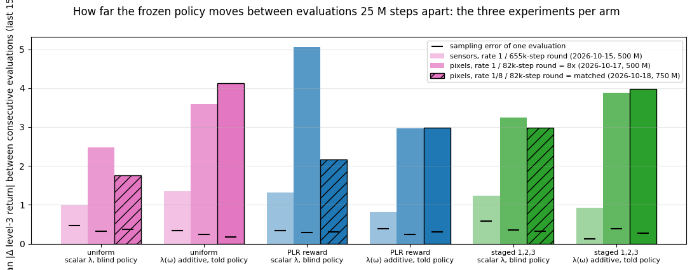
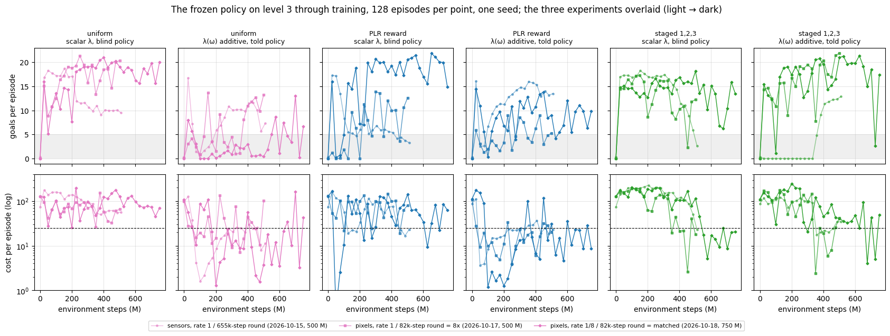
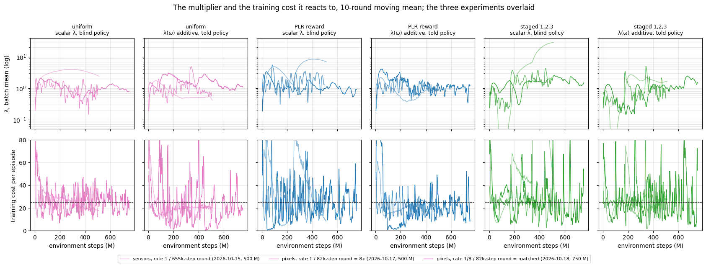

# Six arms from pixels, the dual ascent matched to the sensors run: the swings between evaluations stay, so they are the pixel policy's, not the multiplier's

Done 2026-10-18 on Snellius: 6 arms in parallel, 8 h 13–28 each on an A100,
~6,400 SBU. W&B group `goal_point_learners_vision_750M`, one seed, commit
`e636e71`. The six arms shared with `2026-10-15` (sensors) and `2026-10-17`
(pixels, eight times the dual ascent per step) are compared across all three.

**In one paragraph.** The 2026-10-17 report left two candidate causes for the
evaluation-to-evaluation swings: the camera, and a multiplier stepping eight
times as often per environment step. This run keeps the camera and matches the
multiplier's rate per step to the sensors run (rate ⅛ per 81 920-step round). The
scalar arms' λ became as quiet as on 2026-10-15; the swings did not go: level-3
return still moves 1.8–4.1 goals between consecutive evaluations (sensors
0.8–1.4; sampling error 0.2–0.4), and the per-round training cost is three to
seven times as variable relative to its mean. The policy from pixels is a
different policy every 25 M steps whatever the multiplier does. Two runs of the
same six arms differing only in the multiplier's rate now disagree at the 500 M
mark by as much as the distributions disagree with each other, so with one seed
nothing ranks the distributions under vision. What does hold: the per-context
constraint keeps level 3 near the budget (PLR additive told 9.4 goals / cost 18,
8 of the last 10 evaluations under 25) and the scalar arms do not (18–20 goals
at cost 57–68), except staged scalar, which this time lands on budget standing
half still (10.5 / 17).

## Question

Does matching the dual ascent per environment step to the sensors run remove the
swings of 2026-10-17, and does the per-context constraint then keep the level-3
budget with a policy that moves? Three distributions (uniform, PLR reward,
staged 1,2,3) under the published scalar-blind learner and the additive told one,
750 M steps so that the 500 M mark is inside the run.

## Setup

As `2026-10-17_goal_point_learners_vision_500M.md` (pixels + sensors, 1024
environments, 4 minibatches × 4 updates, 81 920-step rounds, 64 × 64 egocentric
camera, three frames stacked, `--gpu_memory_fraction 0.75`) with two changes:

| | 2026-10-17 | this run |
|---|---|---|
| `--lagrangian_coef_rate` | 1 per round | **0.125** per round = 2026-10-15's 1 per 655 360-step round, exactly (both constraints apply `rate × (cost − budget)` once per round) |
| steps / evaluations | 500 M / 21 | **750 M / 31** (25 M apart, as before) |
| arms | 15 | 6 |

```bash
.venv/bin/python -m training.experiments.snellius scripts/experiments/goal_point_learners_vision_750M.py \
  --partition gpu_a100 --time 10:00:00
```

Mechanics: 0 recompiles, 26.8–27.1 k SPS, 372 records and 31 whole-learner
checkpoints per arm in W&B. Figures:
`scripts/analysis/goal_point_learners_vision_750M_figures.py`; the interactive
page **[`trajectories.html`](figures/2026-10-18_goal_point_learners_vision_750M/trajectories.html)**
plays all three experiments through the return–cost plane.

## Results

### The swings stayed at the matched rate: they are the policy's



Per arm, the mean change of level-3 return between consecutive evaluations
(last 15), in the three experiments; the tick is the sampling error of one
128-episode evaluation.

| | sensors (10-15) | pixels, 8× rate (10-17) | pixels, matched rate (this run) |
|---|---|---|---|
| \|Δ return\| between evaluations | 0.8 – 1.4 | 2.5 – 5.1 | **1.8 – 4.1** |
| sampling error of one evaluation | 0.1 – 0.6 | 0.2 – 0.4 | 0.2 – 0.4 |
| λ, sd / mean (last fifth) | 0.04 – 0.11 | 0.16 – 0.53 | 0.14 – 0.27 |
| sd of λ's step per 655 k steps, scalar arms | 0.001 – 0.027 | 0.068 – 0.113 | **0.007 – 0.026** |
| sd of λ's step per 655 k steps, additive arms | 0.003 – 0.008 | 0.060 – 0.122 | 0.025 – 0.106 |
| training cost per round, sd / mean | 0.09 – 0.32 | 0.24 – 0.76 | **0.41 – 1.00** |

- **The multiplier was matched and the swings were not.** On the three scalar
  arms λ now moves per 655 k steps exactly as on 2026-10-15 (0.007–0.026 against
  0.001–0.027), yet their level-3 return still jumps 1.8–3.0 goals between
  evaluations against 1.0–1.3 before. The told arms swing 3.0–4.1, the same as
  at the 8× rate. The hypothesis of 2026-10-17 — that the swings were the
  integrator overshooting — is refuted.
- **The additive λ(ω) did not slow down with the rate.** Its step noise fell
  by 1.2×, the scalar's by 10×. Inferred cause: the function is fitted to the
  integrator's targets by a fixed number of Adam steps at a fixed learning rate
  each round (`additive.py`, `SOLVE_ITERATIONS`, `SOLVE_LEARNING_RATE`); Adam
  moves at about its learning rate however close the targets are, so eight times
  the rounds is eight times the movement whatever `rate` says. The additive
  form's "rate" is the fit's, not the flag's.
- **The pixel policy is noisier round to round.** Training cost per round
  varies 0.41–1.00 of its mean against 0.09–0.32 with sensors; a round here
  holds 82 episodes against 655, which alone would raise the spread 2.8×
  (0.09 → 0.25), not 4–5×. Training return per round for the told arms: 0.24–0.31
  of its mean against 0.01–0.07.

### The end states: the per-context constraint holds, the ranking does not



Mean of the last five evaluations (650–750 M); "≤ budget" counts the last ten.

| arm | L3 return | L3 cost | L3 ≤ budget | Ω return | Ω cost | at 500 M in this run | 10-17 end (500 M) |
|---|---|---|---|---|---|---|---|
| uniform scalar blind | 18.3 | 68 | 0 / 10 | 24.1 | 23 | 19.8 / 139 | 18.4 / 50 |
| uniform additive told | 5.6 | 50 | 7 / 10 | 13.8 | 25 | 1.0 / 15 | 11.7 / 43 |
| PLR reward scalar blind | 19.5 | 57 | 2 / 10 | 23.6 | 18 | 18.9 / 74 | 9.4 / 73 |
| PLR reward additive told | **9.4** | **18** | **8 / 10** | 17.5 | 17 | 11.1 / 35 | 5.7 / 21 |
| staged scalar blind | 10.5 | 17 | 8 / 10 | 14.6 | 8 | 16.4 / 115 | 9.5 / 21 |
| staged additive told | 14.5 | 39 | 2 / 10 | 18.3 | 10 | 17.3 / 54 | 19.6 / 20 |

- **Two runs of the same arms at the same step disagree as much as the arms
  do.** At the 500 M mark this run and 2026-10-17 differ by 1.0 vs 11.7 goals
  (uniform additive), 18.9 vs 9.4 (PLR scalar), 16.4 vs 9.5 (staged scalar);
  the only intended difference is the multiplier's rate, which the first
  section shows is not what moves the policy. Read as two seeds, the
  between-run spread under vision is 5–10 goals; the between-distribution
  spread within one run is the same size. **No ranking of distributions under
  vision is readable from one seed**, including 2026-10-17's "staged is best".
- **The per-context constraint keeps level 3 at the budget where the policy
  moves.** PLR additive told ends at 9.4 goals / cost 18, under budget in 8 of
  the last 10 evaluations, with 17.5 goals on Ω; its last eleven evaluations read
  4–12 goals at cost 5–35. Uniform additive told is under budget 7 of 10 but
  mostly standing still (0–13 goals, one evaluation at cost 162). Staged additive
  told scores 15–21 goals through 500–700 M at cost 25–95 — the return of
  2026-10-17's staged arm at twice its cost — then 3 / 5 and 17 / 49.
- **The scalar arms at 18–20 goals pay cost 57–68** (uniform, PLR), the
  one-trade-off policy as always; staged scalar is the exception at 10.5 / 17,
  under budget 8 of 10, after its level-3 phase (last eleven evaluations:
  cost falls 116 → 9–25, return 18 → 6–16). One seed; on 2026-10-15 the same
  arm wound λ to 29 and failed.

### The multiplier is quiet and the cost is not



- **λ's batch mean stays between 0.3 and 2.6 for the last 250 M on every arm**
  (means 1.0–1.8; upper row, dark line), with none of the 2026-10-17 excursions; λ at the hardest
  context ends at 11 on the uniform and PLR told arms (2026-10-15: 4–6;
  2026-10-17: 20–27) and at 1.5 on staged.
- **The training cost under it swings 5–60 round to round** (lower row): the
  constraint is reacting to a policy that changes faster than it does. That is
  the same picture as 2026-10-17 with the integrator's own noise removed.

### The control: sensors at the small round do not swing, so the round is not the cause

Added 2026-10-18 evening (group `goal_point_learners_sensors_small_round`: the
six arms with the sensor observation at the pixel runs' batch shape — 1024
environments, 4 minibatches, an 81 920-transition round — and rate ⅛, 500 M,
3 h 07–19 each on an A100, ~2,000 SBU). The round's size governs every per-round
statistic the method computes (`design/training_round.md`); this run holds the
observation fixed and shrinks only the round.

| arm | sensors, 655 k round | **sensors, 82 k round** | pixels, 82 k round |
|---|---|---|---|
| uniform scalar blind | 0.99 | 1.75 | 1.76 |
| uniform additive told | 1.35 | **0.60** | 4.13 |
| PLR reward scalar blind | 1.31 | **0.63** | 2.17 |
| PLR reward additive told | 0.82 | **0.44** | 2.99 |
| staged scalar blind | 1.23 | 1.78 † | 2.99 |
| staged additive told | 0.92 | 2.11 † | 3.98 |

Mean |Δ level-3 return| between consecutive evaluations, last 15; sampling
error 0.2–0.5 in every cell. † the level-3 stage switch falls inside the window
(staged scalar: cost 167, 136 → 8, 1 across it).

- **The small round makes the sensor policy smoother, not rougher**, on the
  four arms without a stage switch (0.4–0.6 against 0.8–1.4). λ is as quiet as
  at the large round (sd/mean 0.05–0.11), the per-round training cost's spread
  rose by the expected √8 (0.09 → 0.18 on uniform scalar), and the per-round
  training return is as steady as before (0.03–0.06 of its mean; the pixel
  runs: 0.25–0.31). Everything the small round changes was present here and
  nothing swung.
- **What remains different between this control and the pixel runs is the
  camera** — the shared encoder, its augmentation redrawn every pass, the
  36 864-value input next to 62 sensor values. The swing is the pixel policy's.
- Two side readings, one seed: the told arms are more motionless at the small
  round (PLR additive told 3.3 goals / cost 15, uniform additive told 5.5 / 17,
  both 10 of 10 under budget — on budget by standing still at 500 M); and staged
  scalar blind lands on budget after its switch (7.9 / 25, 7 of 10) for the
  second run in a row, against the 2026-10-15 arm's wind-up to λ 29.

The pixel run at the large round (`goal_point_learners_vision_large_round.py`)
was defined for the other outcome and is not run: its 3-round smoke on an H100
measured a 97 GiB epoch program at 32 minibatches (11 GiB per 81 920
transitions of frames, ~18 bytes per pixel: XLA holds float32 copies across the
program), so the full round does not fit any card we have, and the control says
it would not have helped.

## What this changes in the plan

1. **Vision is set aside** (`decisions/2026-10-18_vision_set_aside.md`). The
   swings are the camera's, the camera did not remove the wall-pressing failure
   it was adopted for, and the variance it adds is one the thesis' one-seed
   arms cannot carry. Experiments return to the sensor observation; the pixel
   composition stays in the code for future work, where `--vision_augment
   false` and the encoder's learning rate are the first two arms.
2. **The additive constraint's movement per round is the fit's, not the
   flag's.** `SOLVE_ITERATIONS` and `SOLVE_LEARNING_RATE` set how far λ(ω)
   moves each round; `--lagrangian_coef_rate` sets only how far the targets
   are. Either the fit's step must scale with the targets' distance, or the
   design doc must say the rate flag does not govern this form. To decide
   before the next told arm.
3. **Seeds before rankings.** Two runs at the same step now disagree by
   5–10 goals on level 3. No statement of the form "distribution A beats B
   under vision" until at least three seeds; the Snellius budget (22,355 SBU
   left after this run, expires 2026-10-31) covers the sensors control and two
   more seeds of a six-arm vision run at 500 M (~10,000 SBU), not three at 750 M.
4. **The level-3 budget under λ(ω) with a moving policy is reproduced**
   (PLR additive told, 9.4 / 18, 8 of 10): the 2026-10-15 result survives the
   camera and the rate change. The wall-pressing failure of 2026-10-17 is
   untested here (records not yet reviewed).
