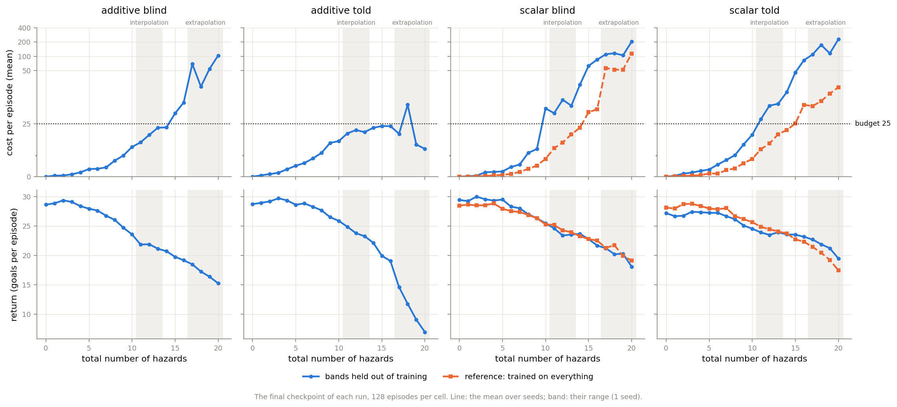
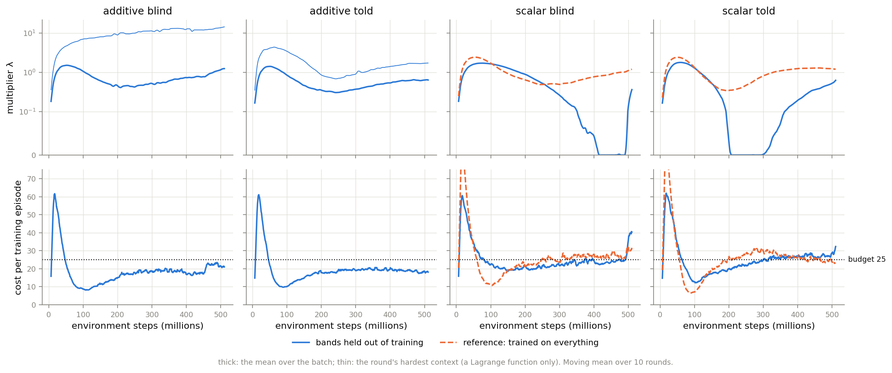

# Does the budget hold on hazard totals the policy never trained on? Seed 0

Written 2026-11-12. W&B group `goal_point_hazard_total_500M`. Step 1 of the
plan, seed 0: **six of eight runs** are done. The references of `additive
blind` and `additive told` were still training; their columns are empty and
this file is redrawn when they finish. One seed is a lean, not a result.

## Question

Four learners train on hazard totals 0–10 and 14–16. Does each hold the budget
of 25 on the totals it trained on, on totals 11–13 (interpolation) and on
totals 17–20 (extrapolation)? And is what we measure at the end of a run a
settled state?

## Setup

`safe_goal_point` with the surface lidar and the Newton contact solver, drag 1,
8192 environments, 1000-step episodes, budget 25, 780 rounds of 655 360 steps
(511 M). 21 evaluations of 128 episodes on each region. Uniform sampling.

| learner | `--constraint` | `--policy_context` | with bands held out | reference (trained on every total) |
|---|---|---|---|---|
| `scalar blind` (PPO-Lagrange) | `scalar` | `blind` | done | done |
| `scalar told` | `scalar` | `told` | done | done |
| `additive blind` | `additive` | `blind` | done | training |
| `additive told` | `additive` | `told` | done | queued |

```bash
# from a second checkout at d3a0b14; the eight jobs of seed 0, one after another
.venv/bin/python -m training.experiments.local scripts/experiments/goal_point_hazard_total_500M.py \
  --only $(.venv/bin/python -m training.experiments.local scripts/experiments/goal_point_hazard_total_500M.py --list | grep '_seed0$')
.venv/bin/python -m training.score --group goal_point_hazard_total_500M
.venv/bin/python -m scripts.analysis.generalization_figures --groups goal_point_hazard_total_500M
.venv/bin/python -m scripts.analysis.generalization_training_figures --group goal_point_hazard_total_500M
```

Mechanics: 0 recompiles, 73–77 k steps per second, **2.5 to 2.6 hours a run**
(the task board said 1.9). Every evaluation episode ran 1000 steps. No episode
left the arena, in training or in evaluation. The runs with bands held out
trained on a mean hazard total of 11.5, the references on 13.6, as intended.

Two numbers are used. The **end state** is the mean of the last five
evaluations (409–511 M, 640 episodes per region). The **final checkpoint** is
the policy at 511 M, scored on every hazard total with 128 episodes each. The
standard error of one 128-episode mean cost is ±5 to ±12 on totals 17–20 for
every run but `additive told` (an episode's cost there has a standard deviation
of 60 to 135), and ±1 to ±4 elsewhere.

## Results

### End state per region

Cost / return (goals per episode). Over the budget in bold.

| run | totals 0–10, 14–16 (trained) | totals 11–13 | totals 17–20 | level 3 (total 20) |
|---|---|---|---|---|
| `scalar blind` | **25.9** / 24.2 | **25.9** / 22.7 | **76.9** / 20.3 | **78** / 15.8 |
| `scalar told` | **28.0** / 26.0 | **26.7** / 25.2 | **84.1** / 22.6 | **193** / 18.4 |
| `additive blind` | 19.1 / 22.7 | 19.9 / 21.8 | **51.9** / 15.6 | **64** / 12.0 |
| `additive told` | 17.8 / 23.9 | 22.2 / 24.0 | 18.5 / 11.5 | 16.9 / 7.8 |
| `scalar blind`, reference | 16.6 / 24.8 | 16.6 / 24.1 | **51.5** / 20.8 | **60** / 17.0 |
| `scalar told`, reference | 17.5 / 24.7 | 17.0 / 24.4 | **48.8** / 20.2 | **47** / 16.5 |

- **Only `additive told` holds the budget beyond the trained totals**: 16 to 21
  on totals 17–20 in each of the last five evaluations. It pays with return,
  11.5 goals against 23.9 on trained totals. On level 3 it costs 17 and reaches
  8 goals. It still moves; whether 11.5 is what the budget costs there or more
  caution than needed is what its reference run will show.
- **One multiplier is over the budget on totals 17–20 even when it trains on
  them**: the references cost 49 to 52 there. So about 50 of `scalar blind`'s
  77 is the averaging. The other 25 is not having seen those totals, or its
  multiplier being at zero (below); this run cannot tell which.
- **A Lagrange function without telling the policy** (`additive blind`) holds
  the budget on trained totals on average and costs 52 on totals 17–20: the
  cost of the PPO-Lagrange reference that trained there, at 5 goals less.
- **Telling the policy without a Lagrange function changes nothing**: `scalar
  told` equals `scalar blind` in every column. Its 193 on level 3 is a few very
  costly episodes (median 70).
- **Interpolation separates no one.** Every run costs on totals 11–13 what it
  costs on its trained totals, within 5.

### The final policy on every hazard total



- **Cost rises with the hazard total and the held-out band 11–13 lies on the
  curve.** Whether a run is under the budget there follows from how high its
  whole curve lies. The mean steps up at total 17 in every blind run, also in
  the reference that trained there, and the median steps much less: that is the
  cost tail of crowded layouts, not the edge of the band.
- **`additive told` is flat at 20 to 24 from total 11 to 16**, on the budget
  where it binds, and falls to 13 at total 20 while its return falls from 19 to
  7. Told a total it never saw, the policy becomes more careful with every
  hazard added. Its one total over the budget (18: mean 34) has a median of 15
  and fewer episodes over the budget than total 17.
- **`additive blind` is over the budget on totals 15 and 16, which it trained
  on** (30 and 35; median 28 and 33), and under it up to 14.
- **`scalar blind` reads worse here than in the table above** (33 on totals
  11–13 against 26). This checkpoint was saved in a cost spike; see below.

### Why the end of a run is not a settled state



The multiplier moves by (cost per episode − 25) / 1000 a round. A run that is
5 under the budget needs 200 rounds to lose 1.

- **With the bands held out, one multiplier falls to zero.** The trained
  totals are easy on average, so cost stays under the budget and λ decays from
  1.7 for 200 to 500 rounds. It is exactly 0 for 104 rounds in `scalar blind`
  (410–490 M) and for 136 rounds in `scalar told` (200–290 M). For that time
  the run is PPO without a constraint.
- **Then cost comes back faster than λ can.** `scalar told` is over the budget
  in training from 330 M to the end (26 to 28) while λ climbs back to 0.6.
  `scalar blind`'s training cost jumps from 25 to 45 in the last 20 M steps;
  its final checkpoint is that jump. Its final evaluation reads 39 on trained
  totals against 19 to 27 in the four before it.
- **The references behave differently, and not because they saw more.** Their
  mix is harder, the constraint binds, and λ ends at 1.2. That is why they cost
  less than the held-out runs even on totals 0–16 (17 against 26). For one
  multiplier, holding totals out changes how tight the constraint is on
  everything else.
- **`additive blind` has not converged.** The multiplier of its hardest
  context rose all run and was still rising at the end (11.9 at 426 M, 14.6 at
  511 M). In `additive told` it is 1.7 and flat: the told policy is on budget
  in its hardest trained contexts at a multiplier of 1.7, the blind one is
  over it at 14.6.

Cost on every region through training, which shows the same drift and how
noisy totals 17–20 are for the blind learners:
`figures/goal_point_hazard_total_500M/evaluation_cost.png`; return:
`evaluation_return.png`.

## What this says about the hypotheses of `thesis.md`

| | Reading at seed 0 |
|---|---|
| H1: one multiplier is on budget on average, over it on hard contexts | fits; clearest in the references, which train on totals 17–20 and cost 50 there |
| H2: a Lagrange function with a blind policy holds every trained context, with lost return | not yet: totals 15 and 16 are over the budget and their multiplier is still rising. 500 M steps do not decide it |
| H3: with a told policy, on budget in each and tight where it binds | fits: 23 to 24 on totals 14–16, no trained total over |

## What this changes in the plan

1. **Score the last five checkpoints, not the last one.** Every run stores 20.
   For a learner whose multiplier swings, the final checkpoint is one moment of
   the swing. `training/score.py` scores only the latest. On the CPU one
   checkpoint takes 30 minutes, so this is a GPU job.
2. **Give every cell a standard error.** On totals 17–20 a 128-episode mean is
   ±10 and the median tells a different story (`scalar blind` at total 20: mean
   204, median 91). The score tables hold no spread.
3. **Decide what PPO-Lagrange's baseline is before three seeds.** With the
   bands held out its multiplier is zero for about a sixth of the run. Either the
   multiplier gets a faster rate (ours is 1; the flag's default is 10), or the
   write-up says that the baseline is unconstrained there.
4. **Read the reference of a one-multiplier learner with care.** It is the
   same learner under a tighter constraint, so its return is not "what was
   achievable". For the per-context learners this does not apply: each context
   has its own budget.
5. **`scalar told` can go.** It equals `scalar blind`; dropping it saves two of
   eight runs per seed (`thesis.md` already proposes this).
6. **Interpolation stays as a free check, not as a result.** The test that
   separates the learners is extrapolation.
7. **H2 needs a longer run or a faster multiplier** before it can be called
   false: λ was still rising.
8. **A run takes 2.6 hours**: 24 runs are 62 hours on this machine, not 47.

Still open at seed 0: the two references. `additive told`'s decides whether
its return on totals 17–20 is the price of the budget.
