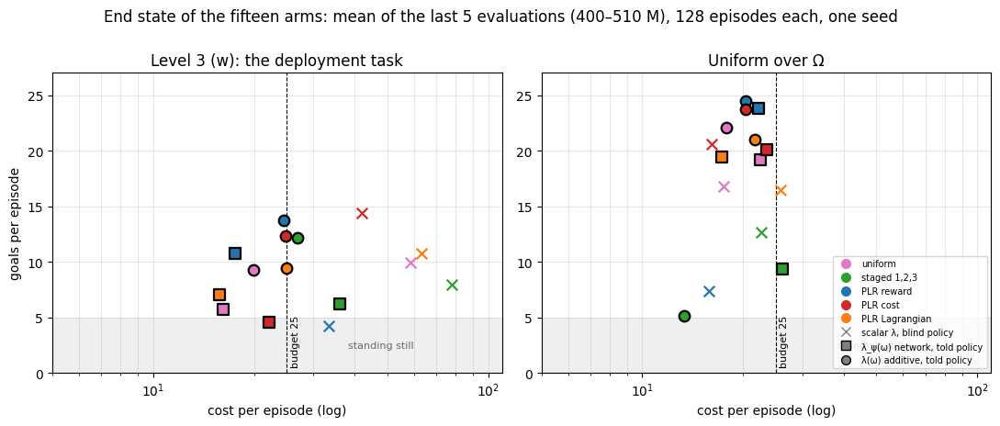
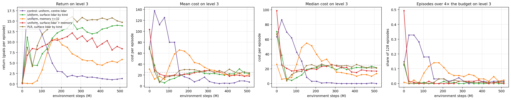

# Progress update, 2026-10-21

Giuseppe Hannen. Four parts, one figure or video each. **The slides are
`progress_update_2026-10-21.pptx`** (ten slides, the videos embedded; built by
`scripts/analysis/progress_update_deck.py`); this file is the same material as
prose, with the commands for the live demo at the end. The full numbers are in
`experiments/2026-10-15_goal_point_learners_500M.md` and
`experiments/2026-10-19_goal_point_cost_tail_500M.md`.

## 1. The per-context constraint works

The problem: PPO-Lagrange has one multiplier λ, and it settles wherever the
policy is on budget *for the contexts the curriculum happens to sample*. Every
curriculum ended at the budget on its own distribution and far over it on
level 3.

The change: the policy and both critics are told the context ω (the hazard
counts and the goal radius), and λ becomes a function λ(ω), fitted each round
to what the integrator asks for. Two forms: a small network, and an *additive*
one — monotone per factor, so an unseen context's multiplier is bounded by its
neighbours'.



*Every arm under λ(ω) ends at the budget on level 3; no scalar arm does. The
additive form keeps more return than the network at the same cost on every
distribution, so it is the default from here.*

## 2. The best policy was hiding a problem

Replaying the best arm to show its episodes, the per-episode costs did not look
like the mean. The figure below is the instrument built to see this: every
episode on a grid of goals × cost, the colour the share of episodes in the cell,
the row at the top every episode costing 50 or more.

→ `experiments/figures/2026-10-19_goal_point_cost_tail_500M/return_cost_mass_level3.html`
(open in a browser; the left panel; drag a rectangle to read the share inside it)

*The typical episode costs half the budget; the mean sits at the budget because
one episode in a hundred costs ten to forty times it. Those few episodes hold
29 % of all the cost and set the multiplier; every other episode pays for them
with caution.*

Watching those episodes: the agent drives into a gap between two solid hazards
that is too narrow, is pushed back, and tries again for the rest of the
episode. The lidar reads only the distance to each hazard's *centre* — a flat
disc it may cross and a solid cylinder it cannot look the same, and the width
of a gap is not in the observation at all.

## 3. What was tried

| | idea | outcome |
|---|---|---|
| a camera | a camera shows kind, extent and occlusion on every suite | same failure with the wall in frame; evaluations swing between checkpoints. Set aside. |
| **geometry** | the lidar as two arrays, passable and solid, reading the hazards' *surface* | §4 |
| **memory** | a trace of recent sensors, actions and costs, so the policy knows it has been here | §4 |

Five arms at 500 M on Snellius, each judged by the new per-episode metrics the
evaluator now logs (median cost, share of episodes over the budget and over four
times it) and by 2048 replayed episodes.



*With the surface lidar the median cost rises to meet the mean and the tail is
gone; the return is the best so far. Memory alone changes neither. The failure
was perceptual.*

## 4. The result, side by side

The same mass figure, all three panels: the old best policy, then the two
surface-lidar policies. The cloud moves up to the budget line and right to more
goals; the top row shrinks from 29 % of the cost to 8 %.

→ `return_cost_mass_level3.html` (and `_level1.html`)

And the published baseline against the best contextual policy on the same
level, 20 s each
(`experiments/figures/2026-10-19_goal_point_cost_tail_500M/videos/`):

| video | shows |
|---|---|
| `level1_typical.mp4` | the baseline hoards the budget on the easy level; the contextual policy spends it and reaches more goals |
| `level3_typical.mp4` | both policies' median episode on the hard level: the contextual one under budget, the baseline over |
| `level3_worst.mp4` | each policy's worst episode: the baseline wedged for 900 steps (cost 1310), the contextual one wedged for 50 and then free (cost 159) |

*One constraint, one policy: at the budget on every level, more goals than the
baseline on every level, a worst case eight times smaller.*

Two things to say honestly. The fix is avoidance, not escape: the agent enters a
trap a third as often, but once inside it gets out no more often than before.
And a constraint on the mean, met by a policy that spends the budget, is
violated in four episodes of ten by small amounts — that is what the constraint
asks for, and the new metrics say so.

## 5. Next

1. A second seed before any claim about which curriculum is best under the new
   observation (PLR led uniform under both lidars, one seed each).
2. Task 2 of the plan: the held-out hazard-count band, the first generalisation
   test, now on an observation whose cost is not set by a tail.
3. Recovery once inside a trap: a recurrent policy, or targeted experience.
4. For Tristan: the surface lidar and the memory part are opt-in and flagged.

---

**To have running during the meeting** (repository root, branch `cost-tail`):

```bash
# the review page: every replayed episode, with the learner's view of each step
.venv/bin/python -m training.review --records ../crax-data/replays_2026-10-20_scalar_blind --port 8788   # baseline
.venv/bin/python -m training.review --records ../crax-data/replays_2026-10-19_plr_centre   --port 8790   # old best
.venv/bin/python -m training.review --records ../crax-data/replays_2026-10-19              --port 8792   # surface lidar
# the mass figures: open the .html files in a browser
```

Episodes to have open: baseline level 3, seed 1 episode 176 (the 1310); old
best level 3, seed 14 episode 36 (the 956); surface lidar PLR level 3, seed 1
episode 04 (19 goals at cost 21) and seed 2 episode 84 (its worst, 159).
